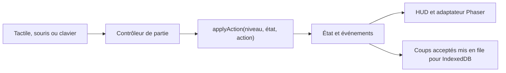

# Architecture de Cozy Room Sort

L’application web est statique. Elle charge les niveaux JSON et les atlas locaux, puis la PWA les met en cache
pour le jeu hors ligne. L’interface et les outils utilisent le même moteur TypeScript.

| Couche | Responsabilité |
| --- | --- |
| Interface web | Accueil, catalogue, réglages, HUD et saisie au clavier. |
| Adaptateur Phaser | Projection des positions, affichage des cadres d’atlas, saisie tactile et souris, animation des événements. |
| Contrôleur de partie | Applique les réglages du mode, transmet les actions, publie les transitions et sérialise les écritures de sauvegarde. |
| Moteur pur | État, accessibilité, coups légaux, rangement, tampon, historique et statut. |
| Solveur | Recherche bornée par états et éventuellement par temps, solutions rejouables, indices et métriques de décision. |
| Générateur | Échantillonne les catégories et objets d’un thème avec une graine, fixe les quotas et place les dépendances. Il soumet chaque candidat au validateur et au solveur. |
| Schémas et validateurs | Migrent et contrôlent le contrat de niveau. La commande de validation vérifie aussi la solution et le seuil de trois étoiles. |
| Persistance IndexedDB | Stocke réglages, scores et journaux d’actions par niveau. La reprise rejoue les actions sur le moteur. |

## Flux d’un coup

Un refus garde l’état courant et émet un événement. Le contrôleur transmet les événements à la scène et au HUD.
Le solveur emprunte la même transition de sélection que le moteur, sans historique. Pour un indice, le
contrôleur lui transmet l’état courant et une horloge.

Les fichiers JSON du catalogue sont produits hors jeu. Les recettes fixent la graine, l’index, le thème, la
difficulté et le titre français. Les parties en cours des anciennes dispositions repartent du début grâce aux
identifiants d’objets renouvelés. Les identifiants de niveau conservent la progression du catalogue.

Le [contrat du niveau et les règles](../specifications/regles.md) détaillent les versions et le score.

## Rendu des écrans

L’accueil met en avant la pièce du dernier niveau joué, ou le salon pour une nouvelle partie. Le catalogue
reprend les vignettes des planches et signale le niveau courant avec la couleur de sa pièce. Les titres
reçoivent le focus après la navigation et les boutons illustrés affichent un anneau au focus clavier.

Le panneau de jeu projette la file du moteur dans l’ordre du niveau. Les cartons en attente portent leur
pictogramme sur un carton fermé, réduit et grisé. Une coche identifie chaque carton rempli. La scène inscrit
la vue carrée dans la zone de jeu et réutilise cette projection pour les objets.
